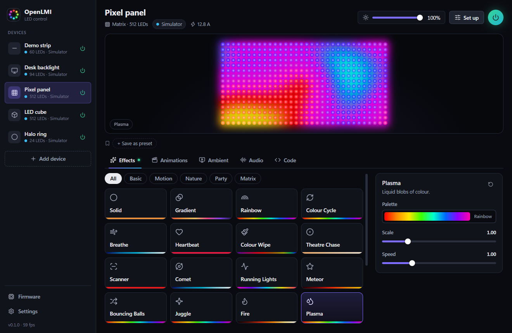
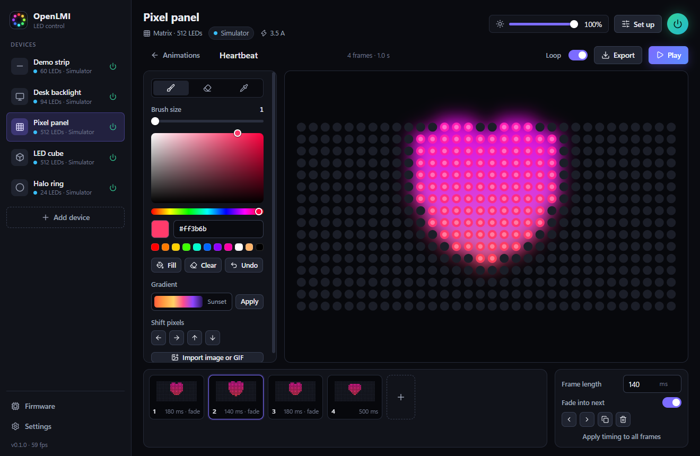
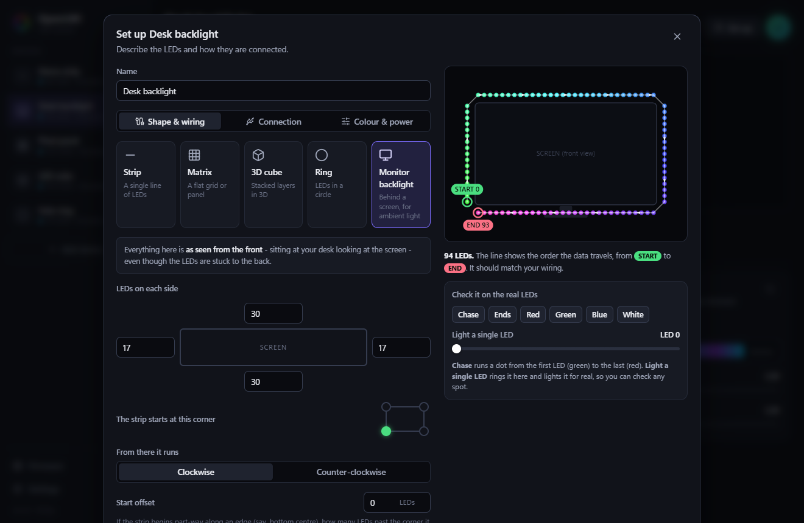
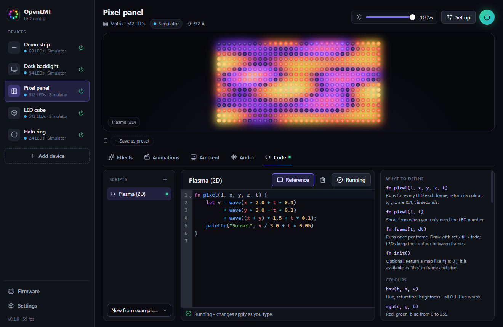
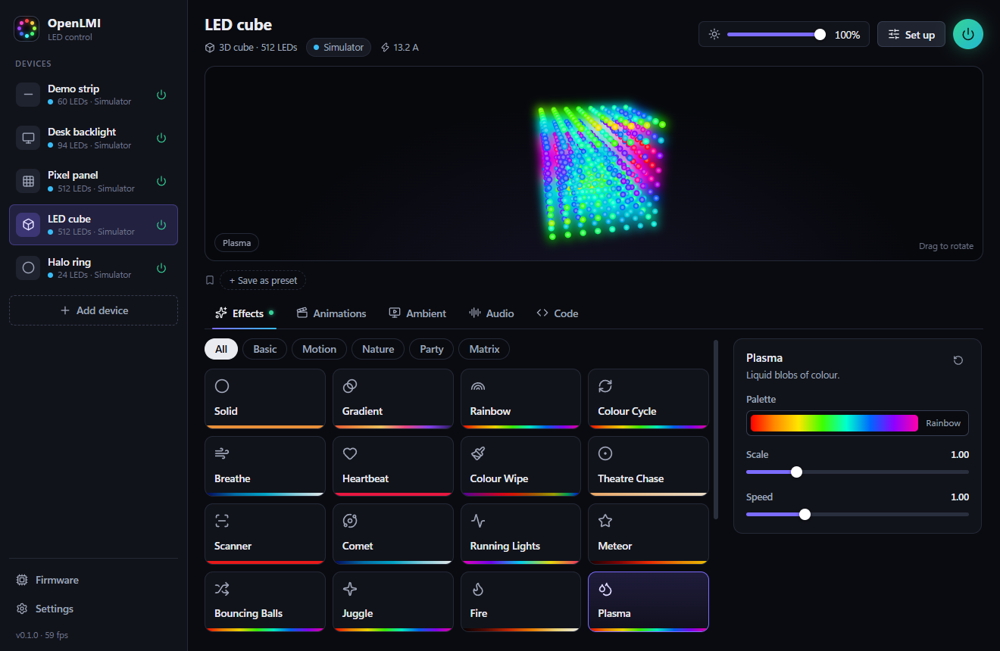
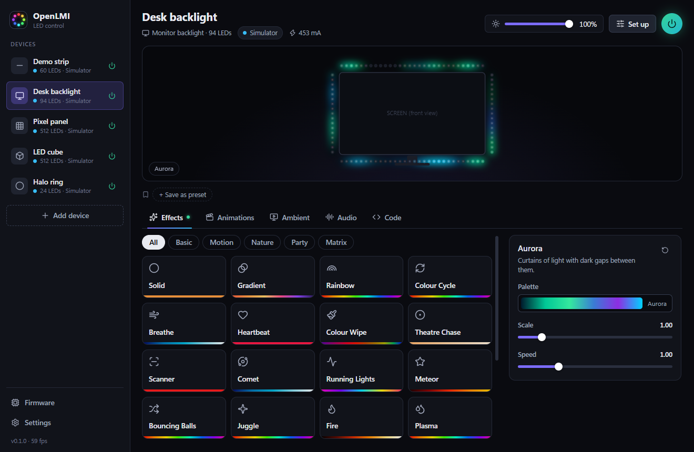

# OpenLMI

**Open Microcontroller LED Integration** - control addressable LEDs on a microcontroller from your PC, without writing code.

Tell OpenLMI what you have (a strip, a matrix, a 3D cube, a ring, a backlight behind your monitor) and how it is wired, then pick an effect, paint your own animation, mirror your screen, react to music - or write a few lines of script when you want full control.



## Download

Get the latest build from the [Releases page](https://github.com/Noxel43/OpenLMI/releases):

| File | Use it when |
| --- | --- |
| `OpenLMI_x.y.z_x64-setup.exe` | You want a normal install with a Start menu entry. Installs for the current user, no admin rights needed. |
| `OpenLMI-vx.y.z-portable.zip` | You want to run it from a folder or USB stick. Unzip and start `OpenLMI.exe`; settings stay in the `data` folder next to it. |

Windows 10/11, 64-bit. It uses the WebView2 runtime that ships with Windows 11 (and current Windows 10).

The builds are not code-signed, so Windows SmartScreen may show a warning the first time: choose *More info > Run anyway*, or [build it yourself](#building-from-source).

## What it can do

- **No code needed.** Everything is point and click, with a live preview of your LEDs.
- **Any shape.** Strips, matrices, 3D cubes, rings and monitor backlights - including how they are wired (start corner, direction, zig-zag, offsets, a gap for the monitor stand).
- **32 built-in effects** in six groups, each with its own controls and palettes: rainbow, fire, plasma, aurora, comets, twinkles, scrolling text and clock for matrices, and more.
- **Animation editor.** Paint LEDs frame by frame, set timing and fades, import images and GIFs onto a matrix, and export an animation as a standalone Arduino sketch that plays with no PC attached.
- **Ambient lighting.** The LEDs follow what is on your screen. Each LED mirrors the part of the picture it sits behind; black bars are skipped; smoothing, saturation and brightness are adjustable. Capture is done on the GPU, so it stays light enough to leave running during films and games.
- **Audio reactive.** Spectrum bars, VU meter, beat pulse and more, driven by whatever your PC is playing (or a microphone).
- **Optional scripting.** A small sandboxed language for when you want to write your own effect, with live reload as you type.
- **Works with common hardware.** USB serial (Adalight, TPM2) and Wi-Fi (DDP, WLED, Art-Net, E1.31). Generates firmware for Arduino-style boards; works with WLED out of the box.
- **Looks after your LEDs.** Brightness, gamma, white balance, colour order and a power budget that dims frames which would draw too much current.
- **Simulator.** Try everything before any hardware arrives.
- Presets, several devices at once, tray icon, start with Windows, backup and restore.

| | |
| --- | --- |
|  |  |
| Paint animations frame by frame | Describe the wiring and check it against a diagram |
|  |  |
| Write your own effects, live | 3D cubes with a rotatable preview |

## Getting started

### 1. Get the microcontroller ready

Pick whichever fits your board:

- **Arduino Uno / Nano / Mega, Pico, or any FastLED-compatible board on USB:** in OpenLMI open **Firmware** in the sidebar, choose your LED type, data pin and LED count, and press **Save sketch**. Open it in the Arduino IDE (install the *FastLED* library first), pick your board and port, and upload. The default sketch is also in [`firmware/OpenLMI_Receiver`](firmware/OpenLMI_Receiver).
- **ESP32 / ESP8266:** flash [WLED](https://install.wled.me). OpenLMI talks to it over Wi-Fi (DDP) or over USB (Adalight) with no extra firmware.
- **Nothing yet?** Use the simulator.

### 2. Add a device

Press **Add device** and work through the three tabs:

1. **Shape & wiring** - what the LEDs are arranged as, and how the strip runs through that shape. The diagram on the right shows the order the data travels, from START to END.
2. **Connection** - simulator, USB / serial (port, baud rate, protocol) or network (address and protocol).
3. **Colour & power** - colour order, gamma, white balance and a power limit.

### 3. Check the wiring

Open **Set up** on the device again. Under *Check it on the real LEDs*:

- **Chase** runs a dot from the first LED (green) to the last (red). It should follow the path in the diagram.
- **Light a single LED** lights one LED on the hardware and rings the same one in the diagram.
- **Red / Green / Blue** show whether the colour order is right.

If something is mirrored or runs backwards, change the start corner or direction until the diagram matches what you see.

### 4. Play

Use the tabs under the preview: **Effects**, **Animations**, **Ambient**, **Audio**, **Code**. The green dot marks the tab that is currently driving the device.

## Describing your LEDs

| Type | What you tell OpenLMI |
| --- | --- |
| Strip | LED count; whether the controller is at the far end. |
| Matrix | Width and height; which corner LED 0 is in; whether the strip runs along rows or columns; zig-zag (serpentine) or not. |
| 3D cube | Width, height, depth; which way the layers are stacked; the wiring inside each layer; whether layers alternate direction. |
| Ring | LED count; where LED 0 sits; clockwise or counter-clockwise. |
| Monitor backlight | LEDs on each side; the corner the strip starts at; clockwise or counter-clockwise; an optional start offset; an optional gap at the bottom for the stand. |

### Monitor backlights and ambient lighting



For ambient lighting to put the right colour in the right place, OpenLMI needs to know where each LED is around the screen.

**Everything is described as seen from the front** - sitting at your desk, looking at the screen - even though the strip is stuck to the back.

1. Count the LEDs along the top, right, bottom and left edges and enter the four numbers.
2. Choose the corner where the wire from the controller reaches the strip.
3. Choose which way the strip runs from there, clockwise or counter-clockwise (again, as seen from the front).
4. If the strip starts part-way along an edge, such as bottom centre, enter how many LEDs past the corner it begins as the *start offset*.
5. If the bottom edge has no LEDs where the stand is, set the *gap for the stand*.

Rotated (portrait) displays and several displays are supported; pick which one to follow in the Ambient tab.

Then use **Chase** to confirm: the dot should travel the same route as in the diagram. In the **Ambient** tab, the preview shows your screen with every LED's sampling area drawn on top in the colour that LED is showing, so a wrong corner or direction is obvious at a glance.

## Connections

| Connection | Protocol | Typical hardware | Default |
| --- | --- | --- | --- |
| USB / Serial | Adalight | Arduino + OpenLMI firmware, WLED over USB | 500,000 baud |
| USB / Serial | TPM2 | WLED and other TPM2 receivers | |
| Network | DDP | WLED (recommended), ESPixelStick | port 4048 |
| Network | WLED realtime UDP | WLED | port 21324 |
| Network | Art-Net | Art-Net nodes and pixel controllers | port 6454 |
| Network | E1.31 / sACN | Pixel controllers | port 5568 |

Serial speed matters: at 115,200 baud a 300-LED strip tops out around 12 frames per second, at 500,000 it manages over 50. OpenLMI paces frames to what the link can carry.

## Writing your own effects

The **Code** tab runs small scripts written in [Rhai](https://rhai.rs), a simple scripting language. Scripts are sandboxed: they can only colour LEDs.

```rust
// Runs for every LED, every frame, and returns its colour.
//   i        LED number          x, y, z   position, 0.0 to 1.0
//   t        seconds since the script started
fn pixel(i, x, y, z, t) {
    hsv(x + y * 0.5 + t * 0.2, 1.0, 1.0)
}
```

Or draw frame by frame, with LEDs keeping their colour between frames:

```rust
fn init() { #{ head: 0.0 } }

fn frame(t, dt) {
    fade(0.9);                                   // leave a trail
    this.head += dt * 40.0;                      // 40 LEDs per second
    if this.head >= led_count() { this.head = 0.0; }
    set(this.head.to_int(), hsv(t * 0.1, 1.0, 1.0));
}
```

Edits apply as you type; if a half-finished edit doesn't compile, the last working version keeps running. The full function list is in [docs/scripting.md](docs/scripting.md) and in the reference panel next to the editor.

## Power

A WS2812B-style LED draws up to about 60 mA at full white, so 100 LEDs can pull 6 A. A USB port supplies around 0.5 A. Use a power supply sized for your LEDs, inject power along long strips, and set a **power limit** under *Set up > Colour & power* (there is a matching limit in the firmware generator). The header shows an estimate of what the current frame draws.

## Settings and data

- Settings live in `%APPDATA%\io.github.noxel43.openlmi\config.json`.
- **Portable mode:** if a folder called `data` sits next to the executable, settings are kept there instead.
- *Settings > Backup* exports and restores everything (devices, animations, scripts, presets) as one file.
- With *Keep running when the window is closed*, OpenLMI stays in the system tray; the tray menu can open the window, switch all lights on or off, or quit.

When OpenLMI exits it turns the LEDs off. The generated firmware also switches them off a few seconds after the PC stops sending.

## Building from source

You need [Rust](https://rustup.rs) (stable), [Node.js](https://nodejs.org) 20 or newer, and on Windows the Microsoft C++ Build Tools.

```bash
git clone https://github.com/Noxel43/OpenLMI.git
cd OpenLMI
npm install
npm run tauri dev      # run with hot reload
npm run tauri build    # build the app and installer
```

The installer ends up in `src-tauri/target/release/bundle/nsis/`, and the standalone executable is `src-tauri/target/release/openlmi.exe`.

Run the backend tests with:

```bash
cargo test --manifest-path src-tauri/Cargo.toml
```

### How it is put together

| Path | What is there |
| --- | --- |
| `src-tauri/src/engine.rs` | The render loop: draws every device, applies brightness, gamma and the power budget |
| `src-tauri/src/layout.rs` | Turns a layout and its wiring into LED positions |
| `src-tauri/src/effects/` | The built-in effects and their parameter schemas |
| `src-tauri/src/ambient.rs` | Screen capture and per-LED sampling |
| `src-tauri/src/screen_dxgi.rs` | Fast screen capture on Windows (desktop duplication, shrunk on the GPU) |
| `src-tauri/src/audio.rs` | Audio capture, spectrum analysis, beat detection |
| `src-tauri/src/script.rs` | The scripting sandbox |
| `src-tauri/src/output.rs` | Serial and network protocols |
| `src-tauri/src/firmware.rs` | Arduino sketch generator |
| `src/` | The user interface (React + TypeScript) |
| `firmware/` | The default receiver sketch |

The backend is Rust ([Tauri](https://tauri.app)); rendering, capture and hardware I/O run on their own threads so the lights keep a steady frame rate regardless of what the window is doing.

## Status

This is an early release (0.1). What has and has not been exercised so far:

- Developed and tested on Windows 11. The code is cross-platform in principle, but Linux and macOS builds are untested.
- The engine, layouts, effects, scripting, ambient sampling and all wire protocols are covered by automated tests, and the network protocols have been checked end to end against a local receiver.
- The serial path and the generated Arduino sketches have not yet been run against physical boards by the author. If something misbehaves on your hardware, please open an issue with the board and LED type.
- RGBW (four-channel) LEDs are driven as RGB; there is no dedicated white channel yet.

Bug reports and pull requests are welcome.

## License

[MIT](LICENSE)
